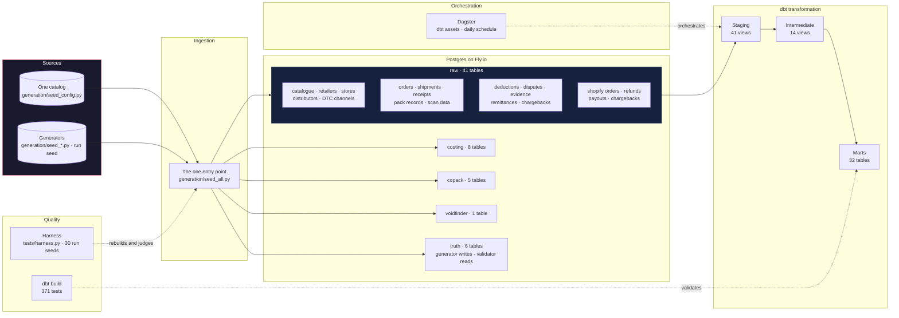

# Cinderhaven Data Platform — Architecture

Counts are run seed 0's world as the harness builds it (2026-11-14). Truth's
tables are named, never counted by row (plan U4).

## Pipeline flow

1. **Sources** — one catalogue, `generation/seed_config.py`, read by every
   generator in `generation/`. `CINDERHAVEN_RUN_SEED` picks the world; run
   seed 0 is today's (plan U2).

2. **Ingestion** — `generation/seed_all.py` is the only write path. In order:
   DDL for raw, truth, costing and copack's five tables; the raw generators
   (shared, retailer, distributor, DTC, scan data, void patterns); product
   master history; copack; a dbt staging build; costing, which reads staging;
   the full `dbt build`; `verify_counts`. dbt is handed the instance the run
   seeded and refuses another.

3. **Schemas** — `raw` 41 tables; `costing` 8; `copack` 5 (that repo's
   snapshot tables are left alone); `voidfinder.store_addresses`; `truth` 6,
   which the generator owns and writes, the validator reads, and no other role
   can reach. Run seed 0 writes 2,305,509 rows outside truth.

4. **Staging** — 41 dbt views over `raw`: type casting, renaming, null
   handling.

5. **Intermediate** — 14 dbt views: the unions across channels, the deduction
   crosswalk, partner resolution, DTC order economics, loaded contribution and
   shelf-space cost by SKU.

6. **Marts** — 32 dbt tables: 7 dimensions, 19 facts, 6 marts (channel
   contribution, three reconciliations, quarterly SPPD, SKU scan totals).

7. **Quality** — `dbt build` runs 371 tests, among them 13 singular tests
   (five are bands). `tests/test_costing_integrity.sql` checks costing's
   referential and rollup integrity. `tests/harness.py` rebuilds the world on
   a local instance; `tests/seed_runs.py` rebuilds it at run seeds 0–29 and
   saves each seed's gates, world hashes and band values.

8. **Orchestration** — Dagster loads every dbt model as an asset and checks
   its login is scoped (`assert_scoped_login`) before building. Its daily
   schedule is 6 AM UTC; nothing runs that schedule against production today.

9. **CI** — `.github/workflows/`: `ci.yml` (fast tier and the truth
   quarantine), `canonical-drift.yml`, `verify-production-figures.yml` (as the
   reader login), and `deploy-costing.yml`, which refuses every dispatch until
   plan U12.
